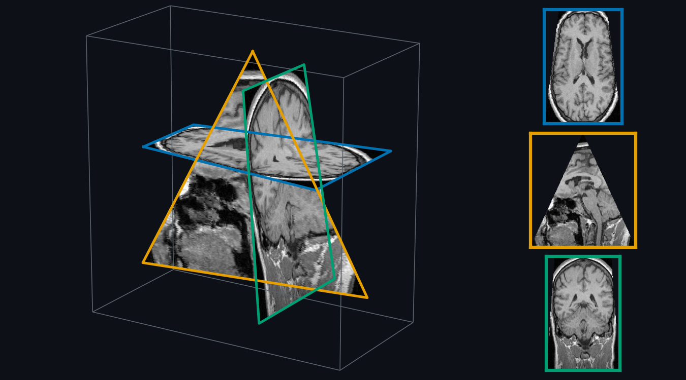
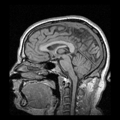

# Plane Projection of a 3D Volume

[](https://github.com/GiladApel/ex1-plane-projection/actions/workflows/ci.yml)   [](https://ex1-plane-projection-wzrd67capf6d5sbscqvb2s.streamlit.app/)

**Ex1, Introduction to Software Engineering, Ariel University.** Given a 3D raster volume `M[x][y][z]` (NRRD, unsigned 8/16/32-bit, `1 <= sx, sy, sz < 2^10`) and a plane given by 3 points (isosceles triangle, `dist(a,b) = dist(a,c)`) or 4 points (isosceles trapezoid), compute the 2D image of the volume on that plane: one pixel per unit step, 0 where a sample falls outside `M`. A CSV file lists the planes; `Ex0.py` renders one video frame per plane.

<table><tr>
<td width="70%"></td>
<td></td>
</tr></table>

*Left: an axial trapezoid, an oblique triangle and a tilted coronal trapezoid through the MRHead scan, each covered with the image `Ex0.py` computes for it. Right: a plane turning 360 degrees ([full video](docs/experiment/mrhead_rotate.mp4), [more runs](docs/EXPERIMENT.md), [try it in the browser](https://ex1-plane-projection-wzrd67capf6d5sbscqvb2s.streamlit.app/)).*

**Scope.** In: NRRD loading (3D, integer 8/16/32-bit; signed data is shifted to unsigned) · triangles and trapezoids in voxel or world coordinates · nearest sampling (default) and trilinear · three interchangeable backends (reference, NumPy, Numba) · CSV in, mp4 out · at least 100 fps on a 500^3 volume (hard minimum 30). Out of scope: GUI, volume rendering, non-uniform voxel spacing in voxel mode, multi-channel volumes.

## Quick start

```
python -m venv .venv
.venv\Scripts\activate            # Linux/macOS: source .venv/bin/activate
pip install -r requirements-dev.txt

python scripts/download_data.py                                   # MRHead and three more volumes
python scripts/make_planes.py rotate data/MRHead.nrrd rotate.csv --axis y --frames 180
python Ex0.py data/MRHead.nrrd rotate.csv rotate.mp4
```

Demo command and options:

```
python Ex0.py file.nrrd file.csv file.mp4 [--fps 15] [--interp nearest|trilinear]
                                          [--backend auto|numba|numpy|reference]
                                          [--world] [--force]
```

CSV formats (all give frames in row order, see SRS FR2). The first is the format of the [lecturer's example sheet](https://docs.google.com/spreadsheets/d/1Tfy1yMYhAJjRBA8ZpRp_07pZXqGtxWhWoP02yZW1FQE/edit):
```
# counted: number of points (3 or 4), then the coordinates; a triangle leaves the fourth point empty
Number of Points (3 or 4),x1,y1,z1,x2,y2,z2,x3,y3,z3,x4,y4,z4
3,200,200,0,0,200,400,400,200,400,,,
4,200,0,0,200,0,500,200,400,0,200,400,500

# plane per row: 9 numbers = triangle (a, b, c), 12 numbers = trapezoid (a', b, a'', c); one frame per row
128,5,60, 28,250,60, 228,250,60

# point per row: 3 rows of x,y,z = triangle, 4 rows = trapezoid; blank line between planes
128,5,60
28,250,60
228,250,60

128,5,70
28,250,70
228,250,70
```
Coordinates are voxel indices; `--world` reads them as NRRD world coordinates. A problem with a whole input (volume, planes file, output folder) produces a one-line `error:` message and exit code 2. A bad row or plane does not stop the run: it gets a `warning:` line and an error frame (gray, showing ERROR, the frame number, the CSV line and the cause), and the summary lists the error frames. Lines starting with `#` are comments. A plane that is not isosceles is projected as given, with a `warning:` line naming its CSV line (`--force` silences it).

## Results

Measured on an i7-13620H (16 threads), Python 3.14, random 500^3 uint8 volume, 500x500 frames, projection only. Full tables: [docs/experiment/benchmark.md](docs/experiment/benchmark.md).

| Backend | Nearest (default) | Trilinear (optional) |
|---|---|---|
| Numba (used when installed) | about 1400 fps (3400 on axis-aligned planes) | about 610 fps |
| NumPy (fallback, 4 threads) | about 390 fps | 35 to 65 fps |

The requirement is 100+ fps, with 30 fps as the hard minimum. Numba stays above 100 fps even on a single thread (295 fps) and on 901 x 901 images (847 fps). NumPy with trilinear sampling is below the target; the CLI prints a warning when that combination is chosen. The NumPy figures depend on core count. Speed against image size: [docs/experiment/speed_by_size.png](docs/experiment/speed_by_size.png). Numbers vary between runs of the same laptop by up to 40 percent.

Demo videos made with `Ex0.py` (details in [docs/EXPERIMENT.md](docs/EXPERIMENT.md)):
[MRHead axial sweep](docs/experiment/mrhead_sweep.mp4),
[MRHead rotation](docs/experiment/mrhead_rotate.mp4),
[MRHead rotation, trilinear](docs/experiment/mrhead_rotate_trilinear.mp4),
[CTChest rotation](docs/experiment/ctchest_rotate.mp4).
End-to-end speed including mp4 encoding: 46 to 393 fps depending on frame size.

Every pixel was also sampled with `vtkImageReslice`, the filter 3D Slicer draws its slice views with: on more than 33 million pixels of nearest-voxel sampling the two agree except for a few points exactly between two voxels ([EXPERIMENT.md](docs/EXPERIMENT.md#comparison-with-3d-slicer)).

## Interactive demo

**Live:** [https://ex1-plane-projection-wzrd67capf6d5sbscqvb2s.streamlit.app/](https://ex1-plane-projection-wzrd67capf6d5sbscqvb2s.streamlit.app/), nothing to install. To run it locally:

```
pip install -r demo/requirements.txt
streamlit run demo/app.py
```

Two tabs:

- **Explore.** Sliders move, turn and size a triangle or trapezoid inside MRHead (downloaded on first use) or a synthetic volume. The page shows the plane in the volume's box, its projected image with the size and the time per plane, and the plane as a row of the lecturer's CSV format, ready to paste into a file for `Ex0.py`.
- **How it works.** A small plane in a 16^3 volume, drawn in 3D with its two rails, every row and every sample point. Clicking a pixel of the image shows each step of the algorithm for that pixel with this plane's numbers: the row's end points a1 and a2, its length d12, the centering offset, the sample index x1, the point p, and the nearest voxel or the 8 trilinear corners with their weights. The page checks the result against the value the reference backend wrote.

The live version runs this file on Streamlit Community Cloud; after a period without visitors it sleeps and takes about a minute to wake up.

## Design in short

- A plane is reduced to two *rails*; triangles and trapezoids share one code path.
- `Projector` is the extension point. `ReferenceProjector` is the literal algorithm and the oracle; `NumpyProjector` and `NumbaProjector` are tested for bit-identical output against it with Hypothesis.
- Whole-file problems are found before any output is written; a bad plane becomes an error frame and the run goes on.
- Class diagram and decisions: [docs/DESIGN.md](docs/DESIGN.md).
- Figures of the algorithm (the plane in the volume, the output image, and our changes to the assignment's pseudo-code): [docs/ALGORITHM.md](docs/ALGORITHM.md).

## Assignment checklist

| To-do item | Where |
|---|---|
| 1. Repository, problem and scope | this README |
| 2. SRS | [docs/SRS.md](docs/SRS.md): requirements with priorities, use cases, traceability to tests; [docs/DEVIATIONS.md](docs/DEVIATIONS.md): every difference from the assignment text |
| 3. Main algorithm in detail | [docs/ALGORITHM.md](docs/ALGORITHM.md), pseudo-code in the docstrings of `src/projection/` |
| 4. Data set of NRRD files | [data/MANIFEST.md](data/MANIFEST.md), `scripts/download_data.py`, `scripts/make_synthetic.py` |
| 5. Testing strategy, including the demo | [docs/TESTING.md](docs/TESTING.md) |
| 6. Implementation, frequent commits | `src/projection/`, git history |
| 7. Demo `python Ex0.py file.nrrd file.csv file.mp4` | [Ex0.py](Ex0.py), `src/projection/cli.py` |
| 8. Experiment and mp4 | [docs/EXPERIMENT.md](docs/EXPERIMENT.md), [docs/experiment/](docs/experiment/) |

Also: [docs/DESIGN.md](docs/DESIGN.md) (architecture).

## Assumptions and changes to the pseudo-code

The assignment's pseudo-code leaves gaps (the apex row, non-integer sizes, fractional points). The ones that matter most:

- **Sampling `v = M[p]`** is read as the nearest voxel, `floor(p + 0.5)` on each axis (trilinear with `--interp trilinear`). Truncation instead would move about half of the pixels; this is the one open point to confirm with the lecturer.
- **Rows and size:** the apex is row 0 (the text moves `a1, a2` before the first row is read), and the image is `floor(Dab) + 1` by `floor(Dbc) + 1`, so every sample has a pixel.
- **Input:** CSV points are voxel indices (`--world` for NRRD world coordinates), in the layout of the lecturer's example sheet; a plane that is not isosceles is projected with a warning.

Every gap and every deviation, with its effect on the image: [docs/DEVIATIONS.md](docs/DEVIATIONS.md) and [docs/SRS.md](docs/SRS.md) sections 5 and 6. Known limitations: a global brightness window per volume, voxel-space projection (spacing is used only by `--world`), and timings from one machine.

## Tests

```
pytest                 # 320 fast tests (the real-data ones need python scripts/download_data.py MRHead)
pytest -m slow         # performance tests (500^3 volume); pytest -m portable runs the subset used in CI
```
CI runs the fast tests, including those on the real MRHead scan, on Python 3.10 to 3.14, each with and without Numba installed, `ruff check .`, `mypy`, and the machine-independent speed tests (Numba thread scaling, Numba versus NumPy).
