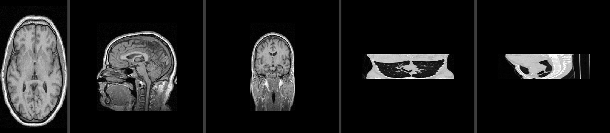

# Plane Projection of a 3D Volume

[](https://github.com/GiladApel/ex1-plane-projection/actions/workflows/ci.yml)

Given a 3D raster volume `M` (NRRD, uint8/16/32) and a plane defined by 3 points (isosceles triangle) or 4 points (isosceles trapezoid), compute the 2D image of the volume projected onto that plane. A CSV file lists the planes; the demo renders one video frame per plane.

Course: Introduction to Software Engineering, Ariel University. Assignment: Ex1.



## Problem

`M[x][y][z]` is an unsigned integer volume of size `sx*sy*sz`, with `1 <= sx,sy,sz < 2^10`. A plane is given by points `a, b, c` with `dist(a,b) = dist(a,c)`. The output image `E` has one pixel per unit step along the plane. Pixels whose sample position falls outside `M` are 0.

The assignment's pseudo-code is not fully defined (off-by-one at the apex, non-integer sizes, float coordinates). Every such gap is resolved explicitly in [docs/SRS.md](docs/SRS.md) and the exact algorithm is in [docs/ALGORITHM.md](docs/ALGORITHM.md).

## Scope

In scope:
- NRRD loading (3D, integer 8/16/32 bit, no multi-component data). Signed data is shifted to unsigned.
- Triangle and trapezoid planes, in voxel-index coordinates (optionally world coordinates).
- Nearest-neighbor sampling (default) and trilinear sampling (optional extra).
- Three interchangeable projector backends: reference (literal loops), NumPy, Numba.
- CSV of planes in, mp4 video out, one frame per plane.
- Performance: at least 100 fps projection on a 500^3 volume (hard minimum 30 fps).

Out of scope: GUI, volume rendering, non-uniform voxel spacing in voxel mode, multi-channel volumes.

## Quick start

```
python -m venv .venv
.venv\Scripts\activate            # Linux/macOS: source .venv/bin/activate
pip install -r requirements-dev.txt

python scripts/download_data.py                                   # MRHead and three more volumes
python scripts/make_planes.py rotate data/MRHead.nrrd rotate.csv --axis y --frames 180
python Ex0.py data/MRHead.nrrd rotate.csv rotate.mp4
```

Demo command and options:

```
python Ex0.py file.nrrd file.csv file.mp4 [--fps 15] [--interp nearest|trilinear]
                                          [--backend auto|numba|numpy|reference]
                                          [--world] [--force]
```

CSV formats (both give frames in row order, see SRS FR2):
```
# plane per row: 9 numbers = triangle (a, b, c), 12 numbers = trapezoid (a', b, a'', c); one frame per row
128,5,60, 28,250,60, 228,250,60

# point per row: 3 rows of x,y,z = triangle, 4 rows = trapezoid; blank line between planes
128,5,60
28,250,60
228,250,60

128,5,70
28,250,70
228,250,70
```
Coordinates are voxel indices; `--world` reads them as NRRD world coordinates. Bad input produces a one-line `error:` message and exit code 2.

## Results

Measured on an i7-13620H (16 threads), Python 3.14, random 500^3 uint8 volume, 500x500 frames, projection only. Full tables: [docs/experiment/benchmark.md](docs/experiment/benchmark.md).

| Backend | Nearest (default) | Trilinear (optional) |
|---|---|---|
| Numba (used when installed) | about 840 fps (1950 on axis-aligned planes) | about 410 fps |
| NumPy (fallback, 4 threads) | about 150 fps | 16 to 35 fps |

The requirement is 100+ fps, with 30 fps as the hard minimum. Numba stays above 100 fps even on a single thread (169 fps). NumPy with trilinear sampling is below the target; the CLI prints a warning when that combination is chosen. The NumPy figures depend on core count.

Demo videos made with `Ex0.py` (details in [docs/EXPERIMENT.md](docs/EXPERIMENT.md)):
[MRHead axial sweep](docs/experiment/mrhead_sweep.mp4),
[MRHead rotation](docs/experiment/mrhead_rotate.mp4),
[MRHead rotation, trilinear](docs/experiment/mrhead_rotate_trilinear.mp4),
[CTChest rotation](docs/experiment/ctchest_rotate.mp4).
End-to-end speed including mp4 encoding: 46 to 393 fps depending on frame size.

## Design in short

- A plane is reduced to two *rails*; triangles and trapezoids share one code path.
- `Projector` is the extension point. `ReferenceProjector` is the literal algorithm and the oracle; `NumpyProjector` and `NumbaProjector` are tested for bit-identical output against it with Hypothesis.
- All input is validated before any output is written.
- Class diagram and decisions: [docs/DESIGN.md](docs/DESIGN.md).
- Figures of the algorithm (the plane in the volume, the output image, and our changes to the assignment's pseudo-code): [docs/ALGORITHM.md](docs/ALGORITHM.md).

## Assignment checklist

| To-do item | Where |
|---|---|
| 1. Repository, problem and scope | this README |
| 2. SRS | [docs/SRS.md](docs/SRS.md) |
| 3. Main algorithm in detail | [docs/ALGORITHM.md](docs/ALGORITHM.md), pseudo-code in the docstrings of `src/projection/` |
| 4. Data set of NRRD files | [data/MANIFEST.md](data/MANIFEST.md), `scripts/download_data.py`, `scripts/make_synthetic.py` |
| 5. Testing strategy, including the demo | [docs/TESTING.md](docs/TESTING.md) |
| 6. Implementation, frequent commits | `src/projection/`, git history |
| 7. Demo `python Ex0.py file.nrrd file.csv file.mp4` | [Ex0.py](Ex0.py), `src/projection/cli.py` |
| 8. Experiment and mp4 | [docs/EXPERIMENT.md](docs/EXPERIMENT.md), [docs/experiment/](docs/experiment/) |

Also: [docs/DESIGN.md](docs/DESIGN.md) (architecture).

## Assumptions to confirm

The assignment leaves three points open; the choices below are documented in [docs/SRS.md](docs/SRS.md) section 6 and are easy to change.

1. CSV coordinates are voxel indices (`--world` switches to NRRD world coordinates).
2. A CSV is either one plane per row (9 or 12 numbers) or one point per row (3 rows per triangle, 4 per trapezoid, planes separated by blank lines). Both are accepted.
3. Nearest-neighbor sampling is the default reading of `v = M[p]`; trilinear is available with `--interp trilinear`.

## Known limitations

- The brightness window is global per volume (padding at the minimum value is ignored), so soft tissue in CT shows with moderate contrast; tissue-specific windows are out of scope (see EXPERIMENT.md).
- Projection works in voxel space; anisotropic voxel spacing is only used by `--world`.
- All timings come from one machine.

## Tests

```
pytest                 # 187 fast tests
pytest -m slow         # performance tests (500^3 volume)
```
CI runs the fast tests on Python 3.10 to 3.14, each with and without Numba installed, plus `ruff check .` and `mypy`.
