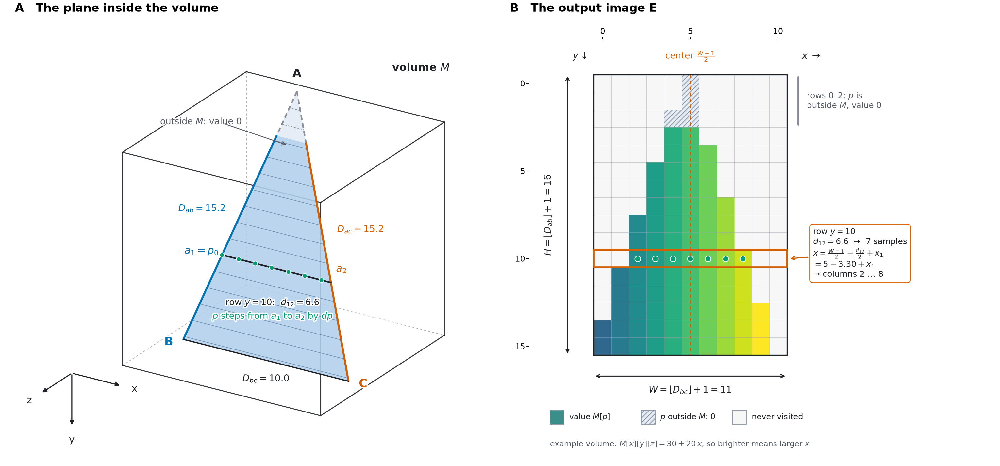
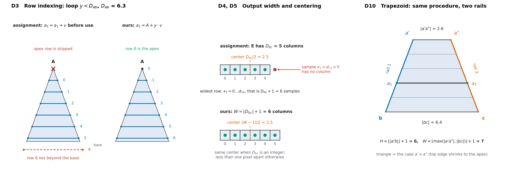

# Algorithm

Decision numbers (D1..D18) refer to [SRS.md](SRS.md).

## 1. Plane to rails

A plane becomes two rails of equal length `L`, each a start point and a unit direction:

```
Triangle (a, b, c):            A1 = a,   B1 = b,   A2 = a,   B2 = c
Trapezoid (a', b, a'', c):     A1 = a',  B1 = b,   A2 = a'', B2 = c

L  = |B1 - A1|                 (equals |B2 - A2| within tolerance, D9)
v1 = (B1 - A1) / L
v2 = (B2 - A2) / L
H  = floor(L) + 1                                   (D3, D4)
Wtop    = |A2 - A1|            (0 for a triangle)
Wbottom = |B2 - B1|
W  = floor(max(Wtop, Wbottom)) + 1                  (D4, D10)
```

Because of this, the projector never distinguishes triangle from trapezoid.



*Figure 1. An isosceles triangle A, B, C (apex A, `Dab = Dac`) cuts through the volume M (A). Each row of the output image E (B) comes from one position of the two rails: `a1` moves from A towards B (blue), `a2` from A towards C (orange), and `p` steps from `a1` to `a2` in unit steps `dp` (green dots). The same row is outlined in orange in both panels. Parts of the plane outside M give 0 (grey, dashed in A; hatched in B). The picture is computed by the code in `scripts/make_figures.py`, with the project's own `Triangle` and `ReferenceProjector`.*

Symbols in the figure and in section 2: `A, B, C` are the plane points, `Dab` the edge length, `Dbc` the base length, `a1, a2` the row ends, `d12 = |a2 - a1|`, `dp` the unit step from `a1` to `a2`, `p` the current sample position, `H` and `W` the image size.

## 2. Projection (nearest neighbor)

```
Input:  volume M (sx, sy, sz); rails A1, v1, A2, v2; sizes H, W
Output: image E of shape (H, W), dtype of M, initialised to 0

for each row y in 0 .. H-1:                          # independent rows, parallel
    a1  = A1 + y * v1                                # D3, D7
    a2  = A2 + y * v2
    d12 = |a2 - a1|
    dp  = (a2 - a1) / d12   if d12 > 0 else (0,0,0)
    off = (W-1)/2 - d12/2                            # centers the row, D5
    for x1 in 0 .. floor(d12):
        p = a1 + x1 * dp                             # closed form, D7
        x = floor(off + x1 + 0.5)                    # D5, D8
        if x < 0 or x >= W: continue
        (i, j, k) = floor(p + 0.5)                   # D8
        if 0 <= i < sx and 0 <= j < sy and 0 <= k < sz:
            E[y, x] = M[i, j, k]                     # D6
        # else E[y, x] stays 0                       # FR5
return E
```

### Worked example

The triangle of Figure 1 is `A = (6, -3, 5)`, `B = (1, 11, 8)`, `C = (11, 11, 8)` in a 12x12x12 volume, with `Dab = Dac = 15.2`, `Dbc = 10`, so `H = 16` and `W = 11`. Values of the first rows (`off` is the offset of the row, `columns` the pixel columns it fills):

| y | a1 | a2 | d12 | off | columns | non-zero pixels |
|---|---|---|---|---|---|---|
| 0 | (6.0, -3.0, 5.0) | (6.0, -3.0, 5.0) | 0.00 | 5.00 | 5..5 | 0 of 1 |
| 1 | (5.7, -2.1, 5.2) | (6.3, -2.1, 5.2) | 0.66 | 4.67 | 5..5 | 0 of 1 |
| 3 | (5.0, -0.2, 5.6) | (7.0, -0.2, 5.6) | 1.98 | 4.01 | 4..5 | 2 of 2 |
| 5 | (4.4, 1.6, 6.0) | (7.6, 1.6, 6.0) | 3.30 | 3.35 | 3..6 | 4 of 4 |
| 10 | (2.7, 6.2, 7.0) | (9.3, 6.2, 7.0) | 6.59 | 1.70 | 2..8 | 7 of 7 |
| 15 | (1.1, 10.8, 8.0) | (10.9, 10.8, 8.0) | 9.89 | 0.05 | 0..9 | 10 of 10 |

Rows 0 and 1 have their samples at `y < -0.5`, outside the volume, so their pixels are 0; from row 3 on the position rounds to `y = 0` and the pixels carry values of M. The table is printed by `python scripts/make_figures.py`.

### Differences from the assignment's pseudo-code

- **D3, row indexing.** The assignment increments `a1` before it is used, so the apex row is never sampled and, with `y < Dab`, the last row can fall beyond the base. We compute `a1 = A + y * v` and run `y = 0 .. floor(Dab)`.
- **D4, D5, width and centering.** The widest row has `d12 + 1` samples (`x1 = 0 .. d12`, both ends), so an `E` with `Dbc` columns would have no column for the last sample. We use `W = floor(Dbc) + 1` columns and center at `(W - 1) / 2`. This is the same center as the assignment's `Dbc / 2` when `Dbc` is an integer, and less than one pixel away otherwise.
- **D6, D7.** `E` is stored as `E[y][x]` (rows first), and positions are computed in closed form, `p = a1 + x1 * dp`, instead of accumulating `p = p + dp`; the values are mathematically equal, but there is no accumulated rounding error and all backends give identical results.
- **D10.** Trapezoids use the same procedure with rails `a' -> b` and `a'' -> c`.



*Figure 2. Left: the assignment's loop skips the apex and its row 6 lands beyond the base (for `Dab = 6.3`); ours starts at the apex. Middle: with `Dbc = 5` the widest row has 6 samples, so the output needs 6 columns. Right: a trapezoid is handled by the same two-rail walk; a triangle is the case `a' = a''`.*

## 3. Trilinear variant

Steps `(i, j, k) = floor(p + 0.5)` and the lookup are replaced by:

```
(i0, j0, k0) = floor(p)
(fx, fy, fz) = p - (i0, j0, k0)
v = sum over the 8 corners (di, dj, dk in {0,1}) of
        w(di,fx) * w(dj,fy) * w(dk,fz) * M_or_0[i0+di, j0+dj, k0+dk]
    where w(0,f) = 1 - f, w(1,f) = f, and M_or_0 is 0 outside the volume
E[y, x] = floor(v + 0.5)
```

The corners are summed in the fixed order `di` outermost, `dk` innermost, and each weight is `wx * wy * wz` evaluated left to right. Every backend uses the same order so floating-point sums are identical.

## 4. Backends

| Backend | Strategy |
|---|---|
| `reference` | Literal nested loops from section 2. Ground truth for tests. |
| `numpy` | For all `(y, x1)` at once, broadcast `a1[y] + x1*dp[y]`, mask, round, gather from the flattened volume. Preallocated buffers. |
| `numba` | Section 2 compiled with `@njit(parallel=True)`, `prange` over `y`, no intermediate arrays, writes into a caller-owned `out`. One kernel per sampler. |

All three compute positions with the same float64 expressions and the same rounding rule, so nearest-sampling output is identical.

## 5. Frame to video

```
window = (p1, p99) percentiles of the volume, computed once          (D12)
Hc, Wc = max H and W over all planes, rounded up to even             (D13)
for each plane (CSV order):
    E     = project(M, plane)
    img   = clip((E - lo) / (hi - lo), 0, 1) * 255  as uint8
    frame = zeros(Hc, Wc); paste img centered
    write frame
```

## 6. Complexity
Per frame: `O(H * W)` samples, one memory read each. Rows are independent, so the work parallelizes over `y`. Memory: the output frame only; the Numba backend allocates nothing else per frame.
