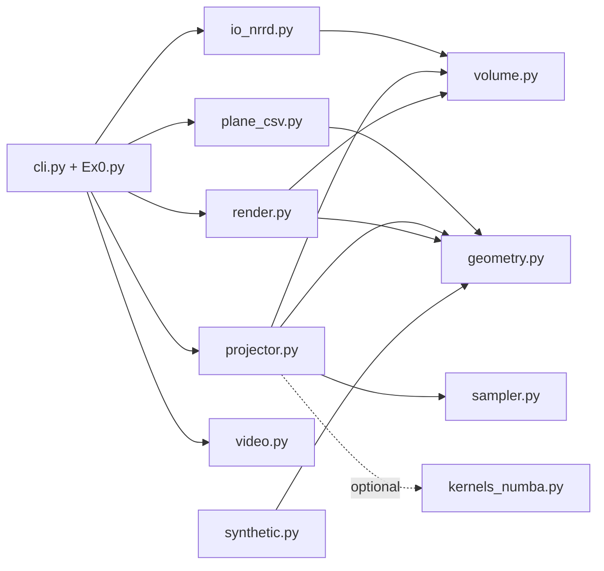
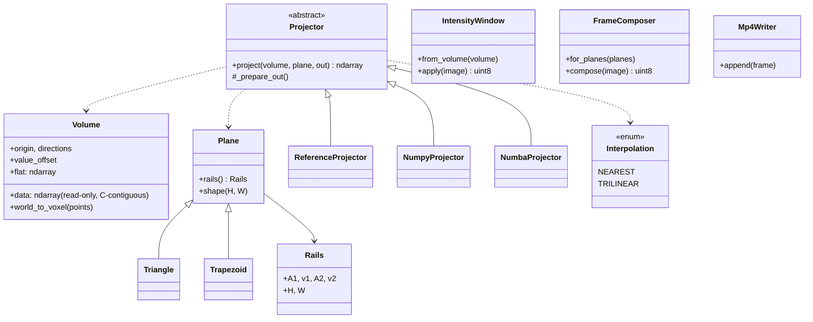

# Design

This document explains how the code is organised and why. The requirements are in [SRS.md](SRS.md), the arithmetic in [ALGORITHM.md](ALGORITHM.md).

## Goals that shaped the design

1. **Correctness is provable.** The assignment's pseudo-code is under-specified, so the first thing built is a slow, literal implementation (`ReferenceProjector`) that every faster backend must reproduce exactly.
2. **Speed without losing correctness.** Two faster backends (NumPy, Numba) sit behind the same interface and are tested for bit-identical output against the reference.
3. **Input problems are reported, not crashed on.** All validation happens before any output is written and raises one exception type, `InvalidInputError`, which the CLI turns into a one-line message and exit code 2.
4. **Each part is replaceable.** Loading, plane geometry, projection, rendering and video writing do not know about each other.

## Modules and dependencies

Dependencies point one way: `geometry.py`, `volume.py`, `sampler.py` and `plane_gen.py` depend on nothing else in the package except small helpers (`errors.py`), so they can be understood and tested alone. `kernels_numba.py` is imported only when the Numba backend is created, so the package works without Numba installed.

## Classes

## Key design decisions

**One abstraction for triangle and trapezoid.** A plane is reduced to two *rails*: a start point and a step vector each, plus the image size (`Rails`). The projector never asks which shape it got. A triangle is a trapezoid whose top edge has length zero. Adding another planar shape only needs a new subclass that produces rails.

**`Projector` as the extension point.** Backends implement `project(volume, plane, out)`. `make_projector("auto")` picks Numba when it can be imported and falls back to NumPy, so the demo runs everywhere. A new backend (for example a GPU one) is a subclass plus one line in `make_projector`.

**Template method for the output buffer.** `Projector._prepare_out` allocates or validates and clears the output array in one place, so all backends treat a caller-supplied `out` buffer identically. The CLI reuses one buffer per frame size, so no allocation happens per frame.

**Sampling as an enum that selects code, not a class per sampler.** `Interpolation` (nearest or trilinear) is chosen once when the projector is built. In the Numba backend it selects one of two separate compiled kernels, which keeps the inner loop free of branches and function calls. The price is that each backend repeats the same arithmetic; this is deliberate (next point).

**The same arithmetic in three places, tied together by tests.** Bit-exact equality needs the same floating-point operations in the same order, so the reference, NumPy and Numba code mirror each other line for line (documented in ALGORITHM.md, including the trilinear summation order). Hypothesis tests compare all three on random planes, every dtype, both samplers, and rounding edge cases, so any drift fails immediately.

**Threads inside the NumPy backend.** Large frames are split into row chunks that run on a thread pool, because NumPy releases the GIL inside array operations. Each chunk does the same arithmetic in the same order, so the output never depends on the thread count (tested). Throughput stops improving at about 4 threads because the indexing steps hold the GIL, so 4 is the default cap.

**Immutable value objects.** `Volume` is frozen with a read-only array, and `Rails` is frozen. Backends cannot corrupt the input, and the volume can be shared safely.

**Fail fast.** The CLI loads the volume, parses and validates every plane, builds the canvas and intensity window, and only then opens the video file. A bad row 500 of the CSV is reported before any frame is rendered.

**Data conversion at the edge.** `io_nrrd.py` converts signed integer data to the unsigned types the algorithm specifies (SRS D17), so everything downstream sees uint8/16/32 only.

**Separate rendering from projection.** The projector returns raw values in the volume's own dtype. `IntensityWindow` (value to 8-bit gray) and `FrameComposer` (centering on a fixed even-sized canvas) are separate classes, so projection results stay exact and the video format can change without touching the algorithm.

## Extending

| To add | Do |
|---|---|
| A projector backend | Subclass `Projector`, register it in `make_projector` and the `BACKENDS` names tuple, add it to the backend list in `tests/test_backend_equivalence.py` |
| A plane shape | Subclass `Plane`, validate in its constructor, pass endpoints to `Plane.__init__` |
| A sampling mode | Add a member to `Interpolation`, a scalar function in `sampler.py` for the reference, and a kernel for each fast backend |
| A video format | Replace `Mp4Writer`; it only needs `append(frame)` and context-manager methods |

## Known trade-offs

- Three implementations of one algorithm cost maintenance effort; the equivalence tests are what make that affordable.
- Rendering uses one global gray window per volume, which is simple and consistent across frames but gives poor contrast on CT data with large padded regions (see EXPERIMENT.md).
- Projection works in voxel space. Anisotropic voxel spacing is only accounted for when `--world` converts the plane coordinates.
