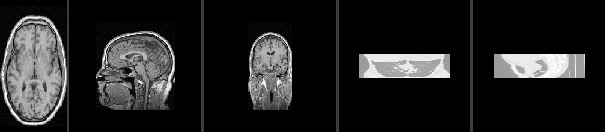
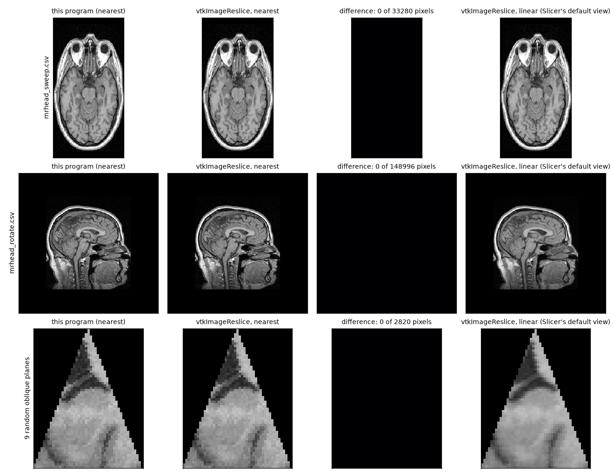

# Experiment

All commands are run from the repository root after `python scripts/download_data.py`. The CSV plane lists and output videos are in [experiment/](experiment/).



## Runs

| # | Volume | Planes | Command | Output |
|---|---|---|---|---|
| 1 | MRHead | 256 rectangles, one per slice along the head's superior-inferior axis (voxel axis y) | `python scripts/make_planes.py sweep data/MRHead.nrrd docs/experiment/mrhead_sweep.csv --axis y`<br>`python Ex0.py data/MRHead.nrrd docs/experiment/mrhead_sweep.csv docs/experiment/mrhead_sweep.mp4 --fps 25` | [mrhead_sweep.mp4](experiment/mrhead_sweep.mp4) |
| 2 | MRHead | 180 planes through the center, rotating 360 degrees around axis y in 2 degree steps | `python scripts/make_planes.py rotate data/MRHead.nrrd docs/experiment/mrhead_rotate.csv --axis y --frames 180`<br>`python Ex0.py data/MRHead.nrrd docs/experiment/mrhead_rotate.csv docs/experiment/mrhead_rotate.mp4 --fps 30` | [mrhead_rotate.mp4](experiment/mrhead_rotate.mp4) |
| 3 | MRHead | same planes as run 2, trilinear sampling | add `--interp trilinear` | [mrhead_rotate_trilinear.mp4](experiment/mrhead_rotate_trilinear.mp4) |
| 4 | CTChest | 180 planes rotating around the long axis z | same as run 2 with `data/CTChest.nrrd`, `--axis z` | [ctchest_rotate.mp4](experiment/ctchest_rotate.mp4) |

## Results

**Correct geometry.** Run 1 reproduces the 256 axial slices of the head in order (frame 0 is the top of the head and frame 255 the neck, following the file's axis direction). In run 2 the plane starts as a sagittal cut (the head seen from the side) and passes through the coronal cut (seen from the front) after a quarter turn, as expected for a plane that contains the rotation axis. The sweep frames are exact slices: the test suite verifies for every axis that a sweep plane returns the same values as the NumPy slice.

**No jitter in the rotation.** The rotating plane has a half-integer side length. With an integer side, floating-point noise made the image size flip by one pixel between frames; a test caught this during development.

**Speed.** Projection-only and end-to-end rates reported by `Ex0.py` on the test machine (i7-13620H, 16 threads, Numba backend, nearest sampling):

| Run | Frame size | Projection fps | End-to-end fps (with mp4 encoding) |
|---|---|---|---|
| 1. MRHead sweep | 256 x 130 | 988 | 393 |
| 2. MRHead rotation | 386 x 386 | 1540 | 137 |
| 3. MRHead rotation, trilinear | 386 x 386 | 890 | 132 |
| 4. CTChest rotation | 740 x 740 | 777 | 46 |

The projection is far above the 100 fps target in every run. The end-to-end rate is limited by H.264 encoding, which grows with frame area; it falls to 46 fps only for the 740 x 740 CT frames.

The table above was measured before the intensity window became a lookup table for uint8 and uint16 images (one table entry per possible value, built once; same output as the formula, verified by a test). The table maps a 740 x 740 frame in 1.7 ms instead of 8.8 ms. End to end, MRHead rotation (386 x 386) went from about 135 to about 210 fps over three runs each; CTChest stayed at about 44 fps, because its frames are limited by the H.264 encoder, which runs in a separate ffmpeg process alongside the mapping.

Detailed projection benchmarks on a 500^3 volume are in [experiment/benchmark.md](experiment/benchmark.md): Numba reaches about 840 fps with nearest sampling on oblique planes and about 410 fps with trilinear, and still exceeds 100 fps on a single thread (169 fps). The NumPy fallback reaches about 150 fps with nearest sampling and 16 to 35 fps with trilinear.

**Findings from the benchmark.**
- Axis-aligned planes are faster than oblique ones (Numba uint8 nearest: 1946 vs 837 fps; NumPy: 230 vs 153). The likely cause (not measured directly) is memory locality: axis-aligned samples walk the volume along regularly strided lines, while oblique samples jump across the 125 MB volume and miss the processor cache.
- Larger voxel types are slower only for oblique planes (Numba nearest: 837 fps for uint8, 708 for uint16, 519 for uint32), probably the same memory effect, since the volume is 125, 250 and 500 MB.
- Trilinear costs 2 to 3.4 times more than nearest on Numba, because it reads 8 voxels per sample.
- Numba threads: 169, 366, 648, 1000, 500 fps for 1, 2, 4, 8, 16 threads. Scaling is close to linear up to 8 threads. In an earlier run 16 threads gave 1052 fps, so the drop at 16 is partly run-to-run noise from oversubscribing this CPU (6 performance and 4 efficiency cores, 16 threads); this was not investigated further.

**Nearest versus trilinear.** Comparing frame 20 of runs 2 and 3 (an oblique plane), nearest sampling shows blocky, stair-stepped tissue edges and trilinear is visibly smoother; 31% of the pixels differ, by 2 gray levels on average. The price is the 2.5x lower projection speed, which is still more than 800 fps.

## Comparison with 3D Slicer

3D Slicer draws its slice views with `vtkImageReslice` from VTK. `scripts/compare_slicer.py` (needs `pip install vtk`, the `slicer` extra) samples every pixel our program fills a second time with `vtkImageReslice`, at the same point of the volume, and compares the two values:

```
python scripts/compare_slicer.py data/MRHead.nrrd docs/experiment/mrhead_sweep.csv docs/experiment/mrhead_rotate.csv --random 200
python scripts/compare_slicer.py data/MRHead.nrrd docs/experiment/mrhead_rotate.csv --random 200 --interp trilinear
python scripts/compare_slicer.py data/CTChest.nrrd docs/experiment/ctchest_rotate.csv --random 100
```

VTK gets only the sample points; it reads the volume itself, with its own axis order, its own rounding to the nearest voxel or linear interpolation, and its own bounds. Only pixels whose sample point lies inside the volume are counted (outside, both programs give 0 by definition). `--random N` adds N oblique planes through the volume, half triangles and half trapezoids, with seed 0. Measured with VTK 9.7.2.

| Volume and planes | Sampling | Planes | Pixels compared | Identical | Different |
|---|---|---|---|---|---|
| MRHead, axial sweep (run 1) | nearest | 256 | 8,519,680 | 100% | 0 |
| MRHead, rotation (run 2) | nearest | 180 | 9,115,648 | 100% | 0 |
| MRHead, random oblique planes | nearest | 200 | 826,612 | 99.998% | 15, all at a half |
| CTChest, rotation (run 4) | nearest | 180 | 14,374,824 | 100% | 0 |
| CTChest, random oblique planes | nearest | 100 | 477,497 | 99.998% | 10, all at a half |
| MRHead, rotation (run 3) | trilinear | 180 | 8,845,892 | 99.997% | 300, by 1 gray level |
| MRHead, random oblique planes | trilinear | 200 | 824,912 | 99.995% | 44, by 1 gray level |



*The middle plane of three sets, drawn by `python scripts/compare_slicer.py data/MRHead.nrrd docs/experiment/mrhead_sweep.csv docs/experiment/mrhead_rotate.csv --random 9 --figure docs/experiment/slicer_comparison.png`. The third column is the absolute difference, 0 on every pixel; the fourth is the smoother linear interpolation 3D Slicer shows by default.*

**Nearest voxel: identical except exactly at a half.** Every differing pixel has its sample point within 0.00001 voxel of the boundary between two voxels on some axis, where both voxels are equally near. This program rounds an exact half up (D8, checked against exact fractions), and VTK computes the rounding at a slightly different floating-point precision, so at such a point the two can pick neighboring voxels. Away from these points the images are the same, which confirms the axis order, the reading of the NRRD file, the rounding rule and the bounds.

**Trilinear: within one gray level.** The two programs blend the same 8 voxels with the same weights; the result is rounded to an integer after the blend, and when it lands within rounding error of a half the two can round to neighboring values. The largest difference is 1. Pixels within one voxel of the volume's edge are left out, because there VTK and this program treat the missing neighbors differently (this program counts them as 0, FR5.1).

This compares how the volume is read at each point. Which points a plane samples follows the assignment's pseudo-code, not 3D Slicer: a Slicer slice view samples a square grid on the plane, so for a triangle its rows are one unit apart across the plane, while the assignment steps one unit along the legs and gives more rows ([DEVIATIONS.md](DEVIATIONS.md#where-this-project-follows-the-text-on-purpose)). For rectangles the two grids are the same.

## Limitations observed

- **CT contrast.** In the first version the CTChest video was pale: 21% of the volume is padding at the minimum value (-3024 HU, shifted to 0 by the loader), which pulled the 1st percentile of the brightness window down to the padding, so air, soft tissue and bone all landed in the upper part of the gray range. The window now ignores the minimum value when it covers at least 5% of the volume (SRS D12): for CTChest the window moved from 0..3327 to 2014..3372, so air is black and the lungs are visible. MRHead hardly changes (0..134 to 1..136). Soft tissue still appears light gray, since one global window covers air to bone; a tissue-specific window (lung or soft tissue) would need user-supplied bounds, which are out of scope.
- **Anisotropic voxels.** The CTChest frames look flattened vertically because the slice spacing is 2.5 mm against 0.76 mm in plane. Projection works in voxel space by design (SRS D15).
- **NumPy fallback speed.** Without Numba, nearest sampling runs at about 150 fps on this machine because the frame is split across 4 threads; with fewer cores it will be slower. Trilinear runs at 16 to 35 fps, below the 30 fps minimum in the worst case, which is why trilinear is only required on Numba.
- **Single machine.** All timings come from one laptop; results on other hardware will differ, especially the Numba thread scaling.
