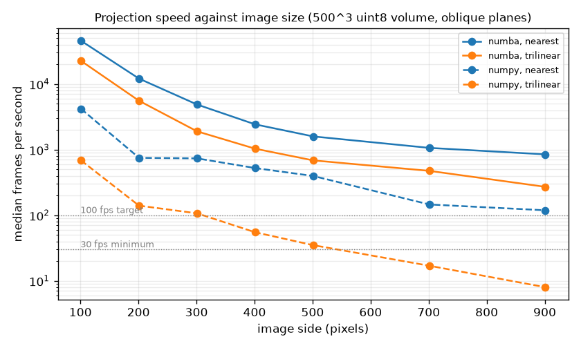

# Benchmark results

Volume 500^3 random data, Intel64 Family 6 Model 186 Stepping 2, GenuineIntel, Python 3.14.3.
Projection time only (plane in, matrix out). Numba runs use 100 planes, NumPy runs
25. Generated by `python scripts/bench_matrix.py`.

## Backend x dtype x sampling x plane orientation

| Backend | Sampling | dtype | Planes | Median fps | p95 ms | Slowest frame fps |
|---|---|---|---|---|---|---|
| numba | nearest | uint8 | oblique | 1403 | 1.11 | 662 |
| numba | trilinear | uint8 | oblique | 611 | 2.61 | 312 |
| numba | nearest | uint8 | axis | 3400 | 0.67 | 1091 |
| numba | trilinear | uint8 | axis | 936 | 1.66 | 358 |
| numba | nearest | uint16 | oblique | 1145 | 1.41 | 400 |
| numba | trilinear | uint16 | oblique | 533 | 3.27 | 272 |
| numba | nearest | uint16 | axis | 2217 | 0.89 | 940 |
| numba | trilinear | uint16 | axis | 913 | 1.62 | 512 |
| numba | nearest | uint32 | oblique | 1039 | 1.40 | 553 |
| numba | trilinear | uint32 | oblique | 482 | 3.24 | 200 |
| numba | nearest | uint32 | axis | 2421 | 0.98 | 811 |
| numba | trilinear | uint32 | axis | 883 | 1.48 | 597 |
| numpy | nearest | uint8 | oblique | 394 | 2.81 | 281 |
| numpy | trilinear | uint8 | oblique | 35 | 37.41 | 22 |
| numpy | nearest | uint8 | axis | 769 | 1.86 | 417 |
| numpy | trilinear | uint8 | axis | 55 | 25.02 | 28 |
| numpy | nearest | uint16 | oblique | 482 | 3.28 | 281 |
| numpy | trilinear | uint16 | oblique | 43 | 33.12 | 27 |
| numpy | nearest | uint16 | axis | 569 | 2.88 | 325 |
| numpy | trilinear | uint16 | axis | 58 | 22.83 | 34 |
| numpy | nearest | uint32 | oblique | 420 | 3.09 | 311 |
| numpy | trilinear | uint32 | oblique | 44 | 31.95 | 30 |
| numpy | nearest | uint32 | axis | 670 | 2.69 | 363 |
| numpy | trilinear | uint32 | axis | 65 | 19.55 | 47 |

## Image size (uint8, oblique squares through the center; image of side x side pixels)

| Image side | Backend | Sampling | Median fps | p95 ms |
|---|---|---|---|---|
| 101 | numba | nearest | 45662 | 0.04 |
| 101 | numba | trilinear | 22548 | 0.06 |
| 101 | numpy | nearest | 4192 | 0.41 |
| 101 | numpy | trilinear | 686 | 2.00 |
| 201 | numba | nearest | 12092 | 0.18 |
| 201 | numba | trilinear | 5557 | 0.23 |
| 201 | numpy | nearest | 750 | 1.53 |
| 201 | numpy | trilinear | 140 | 8.11 |
| 301 | numba | nearest | 4873 | 0.34 |
| 301 | numba | trilinear | 1901 | 0.91 |
| 301 | numpy | nearest | 736 | 1.73 |
| 301 | numpy | trilinear | 107 | 10.07 |
| 401 | numba | nearest | 2429 | 0.59 |
| 401 | numba | trilinear | 1034 | 1.77 |
| 401 | numpy | nearest | 524 | 2.35 |
| 401 | numpy | trilinear | 55 | 21.17 |
| 501 | numba | nearest | 1591 | 0.88 |
| 501 | numba | trilinear | 686 | 2.71 |
| 501 | numpy | nearest | 397 | 3.94 |
| 501 | numpy | trilinear | 35 | 33.77 |
| 701 | numba | nearest | 1064 | 1.51 |
| 701 | numba | trilinear | 475 | 3.34 |
| 701 | numpy | nearest | 146 | 7.84 |
| 701 | numpy | trilinear | 17 | 71.46 |
| 901 | numba | nearest | 847 | 2.07 |
| 901 | numba | trilinear | 271 | 5.40 |
| 901 | numpy | nearest | 119 | 9.36 |
| 901 | numpy | trilinear | 8 | 143.28 |

## Numba thread scaling (uint8, nearest, oblique)

| Threads | Median fps | p95 ms |
|---|---|---|
| 1 | 295 | 4.85 |
| 2 | 619 | 2.05 |
| 4 | 1032 | 1.90 |
| 8 | 1338 | 1.11 |
| 16 | 1087 | 1.53 |
